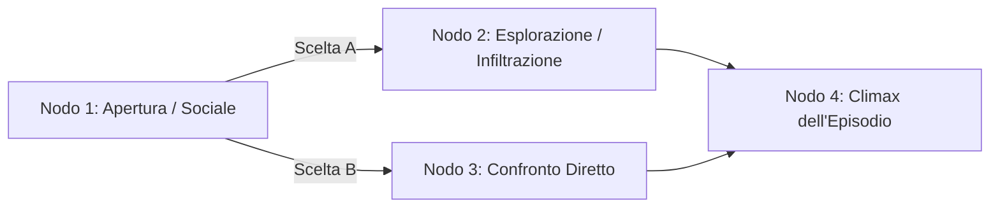

# Preparazione Sessione: Framework Modulare (`prep-sessione`)

Questa skill guida la preparazione delle sessioni secondo una logica di **avventura modulare a blocchi**: nodi di scene autosufficienti, collegati da bivi situazionali, integrati con le passive pre-calcolate del party (`AGENTS.md` Regola 6) e la reattività del mondo vivo (`mondo-vivo`).

---

## Fonti di Input Obbligatorie
Prima di scrivere la preparazione della sessione:
1. Leggi l'ultimo recap in `<Vault>/Sessioni/` (o `Diario di Campagna.md`).
2. Leggi `<Vault>/Campagna/Stato del mondo.md` (data in-game, posizione, orologi di fazione attivi).
3. Consulta `<Vault>/Campagna/Archi Narrativi.md` per collocare l'episodio nell'arco corrente.
4. Consulta le schede dei giocatori in `<Vault>/Campagna/Giocatori/` (obiettivi, legami e valori passivi).

> [!IMPORTANT] Master-as-Reviewer
> Prima di fissare nuovi PNG, istituzioni, lettere o colpi di scena non presenti nel Vault, proponi sempre 2–3 opzioni al Master e attendi conferma (`master-reviewer-autorita-narrativa.md`).

---

## Struttura dell'Output: `<Vault>/Sessioni/Prep Sessione NN.md`

### 1. Inquadramento dell'Episodio (Framing & Obiettivo)
- **Tipo di Struttura:** Basata su Luoghi (*Site-Based*), Basata su Eventi (*Event-Based*) o Ibrida.
- **Obiettivo Principale:** Cosa devono ottenere, scoprire o sventare i PG in questa sessione.
- **Posta in Gioco & Timer:** Cosa accade se falliscono o tardano.
- **Aggancio di Apertura:** Come si apre la scena (ripresa immediata, convocazione, evento scatenante).

### 2. Flusso dei Nodi di Scene Modulari
Organizza l'avventura come un diagramma a nodi intercambiabili:

Per ogni nodo definisci chiaramente:
- **Tipo di Scena:** *Sociale / Investigativa*, *Esplorazione / Rischio Ambientale*, *Combattimento Tattico*, oppure *Enigma / Trappola*.
- **Contenuto Operativo:**
  - Se **Sociale:** PNG presente, motivazione, leva di scambio/pressione, informazioni concrete che possiede e passive di Intuizione/Percezione pre-calcolate.
  - Se **Esplorazione / Trappola:** Descrizione sensoriale in 5 secondi, CD calibrate (`⚡ Passiva Automatica` vs `🎲 Tiro Attivo`), pericoli fisici o meccanici.
  - Se **Combattimento:** Budget PE per il livello del party (`incontri-e-bottino`), terreno con elementi tattici (coperture, dislivelli, luci), link agli statblock `[[Nome Mostro]]`, scena/token Atlas VTT necessari (`vtt-sync-boundaries.md`), e condizioni di vittoria alternative al semplice massacro.
- **Trigger di Uscita:** Come e verso quale altro nodo i PG transitano in base alle scelte.

### 3. Complicazioni & Colpi di Scena (Twists)
Includi 1–2 complicazioni modulari attivabili dal DM per variare il ritmo (es. arrivo di una pattuglia di fazione rivale, timer ambientale, dilemma morale).

### 4. Living World Fallout (Ricadute sul Mondo Vivo)
Specifica quali orologi in `Stato del mondo.md` avanzano se:
- I PG hanno pieno successo;
- I PG subiscono battute d'arresto o si ritirano;
- Le fazioni fuori scena compiono la loro mossa automatica.

### 5. Ricompense, Tesoro & Milestone
- **Bottino:** Monete, gemme o oggetti coerenti con il Tier del party (`incontri-e-bottino`).
- **Oggetti Magici:** Eventuali link a `[[Nome Oggetto]]` con rarità e sintonia.
- **Progresso Milestone:** Avanzamento rispetto all'Arco corrente.
