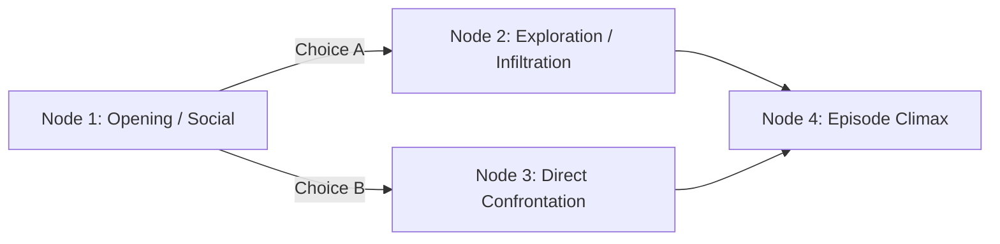

# Modular Session Preparation (`session-prep`)

This skill structures upcoming sessions as **interchangeable scene nodes** connected by situational branches, integrated with pre-calculated party passives (`AGENTS.md` Rule 6) and living-world faction consequences (`living-world`).

---

## Required Context Reads
Before drafting session prep:
1. Read the latest session recap in `<Vault>/Sessions/` (or `Campaign Log.md`).
2. Read `<Vault>/Campaign/World State.md` (in-game date, location, active faction clocks).
3. Consult `<Vault>/Campaign/Story Arcs.md` to position the episode inside the active arc.
4. Consult player character sheets in `<Vault>/Campaign/Players/` (personal goals, bonds, and passive scores).

> [!IMPORTANT] DM-as-Reviewer
> Never lock in new NPCs, institutions, handouts, or twists absent from the vault without proposing 2–3 options to the DM first (`dm-reviewer-narrative-authority.md`).

---

## Output Format: `<Vault>/Sessions/Prep Session NN.md`

### 1. Episode Framing & Goal
- **Structure Type:** Site-Based, Event-Based, or Hybrid.
- **Primary Objective:** What the party wants to uncover, secure, or prevent this session.
- **Stakes & Timer:** What happens if the party delays or fails.
- **Opening Hook:** Exact starting situation (immediate continuation, summons, or inciting event).

### 2. Modular Scene Node Flow
Map the session as flexible, reusable scene nodes:

For each node, specify:
- **Scene Type:** *Social / Investigation*, *Exploration / Environmental Hazard*, *Tactical Combat*, or *Puzzle / Trap*.
- **Operational Content:**
  - **Social:** Present NPC, motive, leverage/bargaining chip, concrete secrets they hold, and pre-calculated Insight/Perception passives.
  - **Exploration / Trap:** 5-second sensory read-aloud, calibrated DCs (`⚡ Automatic Passive` vs. `🎲 Active Roll`), physical/mechanical hazards.
  - **Combat:** 5e XP budget (`encounters-and-loot`), tactical terrain features (cover, elevation, lighting), `[[Monster]]` statblock links, required Atlas VTT scene/tokens (`vtt-sync-boundaries.md`), and alternate win conditions beyond wiping out every foe.
- **Exit Triggers:** How player choices transition into adjacent nodes.

### 3. Complications & Twists
Include 1–2 modular complications the DM can drop in to adjust pacing (rival patrol arrival, environmental timer, moral dilemma).

### 4. Living World Fallout
Specify which faction clocks in `World State.md` advance if:
- The party succeeds cleanly;
- The party retreats or suffers a setback;
- Off-screen factions execute their scheduled moves.

### 5. Rewards, Treasure & Milestone Progress
- **Loot:** Coins, gems, or gear appropriate to party tier (`encounters-and-loot`).
- **Magic Items:** Wikilinks to `[[Item Name]]` noting rarity and attunement.
- **Milestone Progress:** How far this episode advances the current story arc.
