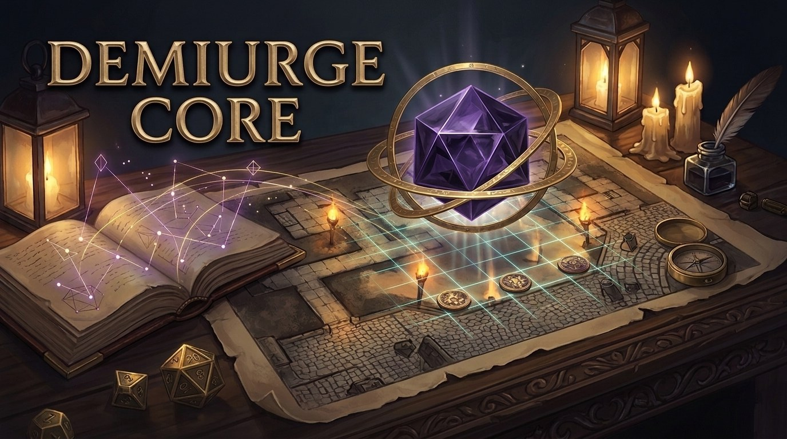
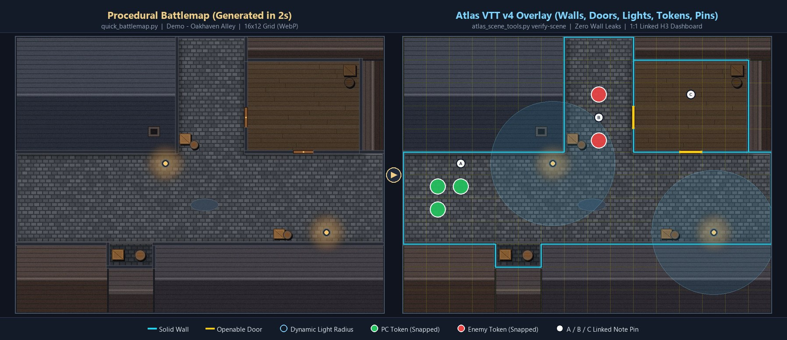
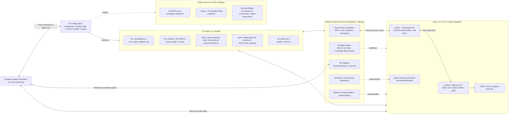

# Demiurge Core



[](https://github.com/tognonm/demiurge-core/actions/workflows/ci.yml)
[](LICENSE)
[](requirements.txt)
[-7C3AED.svg)](https://github.com/atlas-vtt/atlas-vtt)

**Demiurge Core** is an open-source, local-first **agentic Dungeon Master framework** for running D&D 5e campaigns with **[Obsidian](https://obsidian.md/)** and **[Atlas VTT 0.16.0](https://github.com/atlas-vtt/atlas-vtt)**.

It pairs strict narrative governance (**DM-as-Reviewer** — the AI never invents canon behind your back) with **10 modular agent skills**, **cross-IDE agent adapters**, **native Obsidian Bases**, a clean two-level vault architecture, and **11 tested Python CLI toolkits** covering 60-second campaign bootstrapping, instant procedural battlemaps, Atlas VTT scene auditing, encounter math, player spoiler firewalls, anti-canon-drift context packs, and audio/Discord transcript preprocessing.

---

## See It in Action

From a single 2-second CLI command (`quick_battlemap.py`) to a validated **Atlas VTT `0.16.0` (`schema v4`)** scene audited by `atlas_scene_tools.py` — complete with sealed sight-blocking walls, openable doors, dynamic lighting radii, grid-snapped PC and enemy tokens, and 1:1 `### H3` Note Pins linked to a `< 5 KB` DM Dashboard:



---

## Key Features

- **60-Second Campaign Setup Wizard (`scripts/init_campaign.py`):** Bootstraps your custom campaign vault from `template-vault/`, generates a fresh campaign UUID v4 and Atlas collection, creates custom PC notes plus `400×400` heraldic monogram WebP tokens, converts grid units (`feet` or `meters`), updates `campaign.config.json` and `AGENTS.md`, and optionally pre-renders 8 Wildcard battlemaps.
- **DM-as-Reviewer Governance (`AGENTS.md` + 7 Rules):** Clear boundaries separating technical automation (XP budgets, YAML, `.atlasmap` assembly, validation) from narrative canon (NPCs, lore, temples, handouts, secrets).
- **Multi-Agent IDE Support (`scripts/sync_agent_adapters.py`):** Works out of the box with **Antigravity**, **Codex**, **Claude Code** (`CLAUDE.md`), **Cursor** (`.cursor/rules/demiurge-core.mdc`), and **GitHub Copilot** (`.github/copilot-instructions.md`). All adapter bridges are auto-generated from `AGENTS.md` and `.agents/` as the single source of truth and drift-checked in CI.
- **Zero-Overlap Skill Architecture (10 Modular Skills):** Distinct scopes for session prep, live improvisation, instant tactical battlemaps, canonical dungeon building, encounter balancing, statblocks, token art registration, audio/Discord transcript preprocessing, post-session recaps, and living-world faction clocks.
- **Two-Level Vault Model (`< 32 KB` Atlas Safe) + Native Obsidian Bases:** Separates rich Lore/Location notes from ultra-lean Atlas VTT Linked Note Dashboards (`< 30 KB`, respecting Atlas VTT's hard 32 KB ceiling) with 1:1 `### H3` Note Pin anchors, **pre-calculated party passive checks** (`⚡ Automatic Passive` vs. `🎲 Active Roll`), and native Obsidian Bases (`Items/Loot.base` wired into Atlas `lootBases` and `Campaign/Campaign Board.base`).
- **11 Tested Python CLI Toolkits:** Covering campaign setup, full Atlas vault linting, player spoiler firewall exports (Quartz / Discord / single Markdown), anti-canon-drift AI context packs, 5e encounter math (`2024` & `2014`), transcript cleaning/chunking, 8 procedural battlemap presets, Atlas wall/light auditing & dashboard scaffolding, live Markdown table rolling, and token registration.
- **Ready-to-Open `template-vault/`:** 100% fictional, spoiler-free, copyright-safe starter vault complete with a DM Screen, Obsidian Bases, World State & Improv Staging Log, multi-compatible demo random table, fictional example party (`Mira`, `Kael`, `Bram`), and a pre-validated Atlas VTT demo scene (`Demo - Oakhaven Alley`).

---

## Architecture: Multi-Agent ↔ Obsidian ↔ Atlas VTT `0.16.0`



---

## Power-User CLI Toolkit

All **11 Python CLI tools** use only Python 3.10+ stdlib plus `Pillow`, `numpy`, and `PyYAML`, run identically on Windows, macOS, and Linux, and are verified by automated `pytest` tests in CI.

| CLI Tool | Purpose | Key Command Example |
| :--- | :--- | :--- |
| **`scripts/init_campaign.py`** | **60-Second Setup Wizard:** Creates a custom campaign vault, UUID, collection, grid units (`feet`/`meters`), PC notes, monogram WebP tokens, and optional Wildcard maps. | `python scripts/init_campaign.py` |
| **`scripts/lint_vault.py`** | **Vault & Full Atlas Linter:** Audits YAML frontmatter, broken `[[wikilinks]]`, Atlas 32 KB limits, token `imagePath`/`statblockPath`, `.atlasmap` pin `#Heading` anchors, `Location` scene refs, and un-triaged `Improv Log.md` `review` rows. | `python scripts/lint_vault.py --strict-links --full-atlas` |
| **`scripts/sync_agent_adapters.py`** | **Multi-Agent Adapter Sync:** Regenerates and drift-checks `CLAUDE.md`, `.cursor/rules/demiurge-core.mdc`, and `.github/copilot-instructions.md` from `AGENTS.md` and `.agents/`. | `python scripts/sync_agent_adapters.py --check` |
| **`scripts/export_player_view.py`** | **Spoiler Firewall & Player Portal:** Exports a player-safe Quartz vault or single Markdown handout; strips `DM Secret`/`spoiler` callouts and `<!-- dm-only -->` blocks, excludes private folders & `visibility: dm-only` notes, sanitizes secret links, and runs an independent `--verify` leak audit. | `python scripts/export_player_view.py --out player-portal --format vault --verify` |
| **`scripts/build_context_pack.py`** | **Anti-Canon-Drift Context Compiler:** Compiles a byte-budgeted Markdown snapshot (party passives, `World State.md`, active quests, factions, recent sessions, pending improv rows, and 1-hop current location). | `python scripts/build_context_pack.py --max-bytes 12000 --out context-pack.md` |
| **`scripts/build_encounter.py`** | **5e Encounter Builder:** Computes 5e XP budgets for **`2024`** (Low/Moderate/High) or **`2014`** (Easy/Medium/Hard/Deadly with size multiplier), action-economy ratio, Markdown encounter note, and Atlas VTT `encounter-*.json`. | `python scripts/build_encounter.py --name "Alley Ambush" --enemies "Road Raider:2,Skeleton Sentry:1" --ruleset 2024 --dry-run` |
| **`scripts/prep_transcript.py`** | **Transcript Preprocessor:** Cleans raw `.srt`, `.vtt`, and `.txt` audio/Discord transcripts (strips timestamps, fillers, noise, rolling dupes, merges consecutive speakers) into overlapping chunks prefixed with a Vault Proper-Noun Glossary. | `python scripts/prep_transcript.py session.srt --out-dir chunks/` |
| **`.agents/skills/quick-battlemap/scripts/quick_battlemap.py`** | **Instant Procedural Battlemaps (8 Presets):** Renders tactical WebP maps + `.atlasmap` v4 scenes + `< 5 KB` DM Dashboards in 2–3s (`whiteboard`, `alley`, `road`, `hills`, `interior`, `camp`, `bridge`, `crypt`) with walls, doors, secret doors, lights, and snapped tokens. | `python .agents/skills/quick-battlemap/scripts/quick_battlemap.py --preset crypt --lighting night --enemies "Road Raider:2,Skeleton Sentry:1" --dry-run` |
| **`.agents/skills/dungeons-and-maps/scripts/atlas_scene_tools.py`** | **Atlas Scene Tools:** Subcommands `grid-preview`, `detect-lights`, `verify-scene`, `validate`, `audit-walls --strict` (detects zero-length, duplicate, near-miss wall gaps & tight lights), and `scaffold-dashboard` (`< 5 KB` 1:1 pin starter dashboard). | `python .agents/skills/dungeons-and-maps/scripts/atlas_scene_tools.py audit-walls "template-vault/atlas-vtt/collections/Campaign/scenes/Demo - Oakhaven Alley.atlasmap" --strict` |
| **`.agents/skills/live-improv/scripts/roll_tables.py`** | **Live Table Roller:** Dynamically indexes and rolls any Markdown `| dN | ... |` table in `<Vault>/Tables/` with seeded reproducibility and configurable presets. | `python .agents/skills/live-improv/scripts/roll_tables.py --preset demo-scene --seed 42` |
| **`.agents/skills/atlas-token-art/scripts/register_token.py`** | **Atlas Token Registrar:** Center-crops portraits into `400×400` WebP tokens + `128×128` thumbnails and writes canonical `tokens/token-*.json` records for Atlas VTT `0.16.0`. | `python .agents/skills/atlas-token-art/scripts/register_token.py portrait.png --name "Iron Warden" --statblock "Monsters/Road Raider.md" --dry-run` |

---

## Native Obsidian Bases

`template-vault/` ships with two ready-to-use native **Obsidian Bases** (`.base` YAML views) with zero extra Dataview plugin dependency:

- **`Items/Loot.base`** — Filterable magic-item and treasure ledger (`Item`, `Rarity`, `Attunement`, `Value (gp)`, `Owner`, `Status`) wired directly into `atlas-vtt/collections/Campaign/collection.json` under `settings.lootBases` so Atlas VTT can surface vault loot natively.
- **`Campaign/Campaign Board.base`** — Multi-view DM campaign board combining an **Active Quests** view (`atlas-type == "quest"`) and a **Party Roster** view (`Campaign/Players`) with live passive Perception, Investigation, and Insight columns.

---

## Required & Recommended Obsidian Plugins

Install these community plugins inside your Obsidian vault (`Settings → Community plugins`):

| Plugin | ID | Required? | Role in Framework |
| :--- | :--- | :---: | :--- |
| **[Atlas VTT](https://github.com/atlas-vtt/atlas-vtt)** (`0.16.0+`) | `atlas-vtt` | **Required** | Local-first VTT: `.atlasmap` v4 scenes, dynamic lighting, walls/doors, tokens, Note Pins, Quests, Encounters, `lootBases`, Player View |
| **[Fantasy Statblocks](https://github.com/Obsidian-TTRPG-Community/fantasy-statblocks)** | `obsidian-5e-statblocks` | **Required** | Renders ```` ```statblock ```` YAML blocks and feeds initiative/HP/tooltips into Atlas VTT |
| **[Dice Roller](https://github.com/Obsidian-TTRPG-Community/dice-roller)** | `obsidian-dice-roller` | **Required** | Inline dice rolls (`dice: 1d6`) and clickable Markdown random tables (`^block-id`) |
| **[Iconize](https://github.com/FlorianWoelki/obsidian-iconize)** | `obsidian-icon-folder` | Recommended | Displays folder and note emojis from YAML `icon:` fields |
| **[Extended Graph](https://github.com/ElsaTam/obsidian-extended-graph)** | `extended-graph` | Optional | Enhanced graph visualization across wikilinks and frontmatter relationships |

---

## 5-Minute Quick Start

### 1. Clone & Install Python Dependencies
Requires **Python 3.10+**.

```bash
git clone https://github.com/tognonm/demiurge-core.git
cd demiurge-core
python -m pip install -r requirements.txt
```

### 2. Verify the Demo Vault & Toolkits Immediately
All scripts default to `template-vault/` via `campaign.config.json`:

```bash
# 1. Full vault & Atlas VTT 0.16.0 integrity lint (YAML, wikilinks, 32 KB limits, pins, tokens)
python scripts/lint_vault.py --strict-links --full-atlas

# 2. Verify multi-agent adapters (CLAUDE.md, Cursor, Copilot) are synced
python scripts/sync_agent_adapters.py --check

# 3. Simulate a Spoiler Firewall player portal export with independent leak verification
python scripts/export_player_view.py --dry-run --verify

# 4. Simulate an instant procedural battlemap (8 presets: whiteboard, alley, road, hills, interior, camp, bridge, crypt)
python .agents/skills/quick-battlemap/scripts/quick_battlemap.py --preset crypt --lighting night --enemies "Road Raider:2,Skeleton Sentry:1" --dry-run

# 5. Validate & strictly wall-audit the included Atlas VTT 0.16.0 demo scene
python .agents/skills/dungeons-and-maps/scripts/atlas_scene_tools.py validate "template-vault/atlas-vtt/collections/Campaign/scenes/Demo - Oakhaven Alley.atlasmap" --dashboard "template-vault/atlas-vtt/collections/Campaign/notes/Demo - Oakhaven Alley.md"
python .agents/skills/dungeons-and-maps/scripts/atlas_scene_tools.py audit-walls "template-vault/atlas-vtt/collections/Campaign/scenes/Demo - Oakhaven Alley.atlasmap" --strict
```

### 3. Bootstrap Your Own Campaign in 60 Seconds
Run the interactive setup wizard (or pass `--non-interactive` flags) to create your personal `Vault/` without mutating `template-vault/`:

```bash
# Interactive 60-second setup wizard
python scripts/init_campaign.py

# Or fully automated one-liner (feet or meters, custom party, optional 8 Wildcard battlemaps)
python scripts/init_campaign.py \
  --name "Ironvale Chronicles" \
  --vault-dir "Vault" \
  --collection "Ironvale" \
  --units feet \
  --party-level 1 \
  --party "Lyra:Cleric:11:14:10:15:torch,Theron:Rogue:10:12:15:11,Garrick:Fighter:13:11:9:10" \
  --with-wildcards \
  --non-interactive
```

### 4. Open in Obsidian & Your AI Coding Agent
1. Open Obsidian → **Open folder as vault** → select `Vault/` (or `template-vault/` to explore the demo first).
2. Enable **Atlas VTT**, **Fantasy Statblocks**, and **Dice Roller**.
3. Open `DM Screen.md` and launch the Atlas VTT scene **`Demo - Oakhaven Alley`**:
   - Press **`Tab`** to toggle the Linked DM Dashboard.
   - Hold **`H`** (*Lighting Peek*) to preview Dynamic Lighting through the party's eyes.
   - Click either warehouse door on the map to open it live.
4. Open the repository root in your AI coding agent (**Antigravity**, **Claude Code**, **Cursor**, **GitHub Copilot**, or **Codex**). Governance and all 10 skills are loaded automatically via `AGENTS.md` and the synced adapter bridges.

---

## Modular Skills & Example Chat Prompts (10 Skills)

| Skill | Tabletop Moment | Example Prompt in Chat |
| :--- | :--- | :--- |
| **`session-prep`** | Modular session prep | *"Compile a context pack and prep Session 4: the party investigates the missing merchant wagon in Oakhaven."* |
| **`dungeons-and-maps`** | Canonical dungeon build | *"Check grid alignment on this tower crypt PNG, audit the walls, scaffold a `< 5 KB` dashboard, and propose room labels A–E."* |
| **`quick-battlemap`** | Sudden ambush live (2–3s) | *"Instant crypt battlemap at night with 2 Road Raiders and 1 Skeleton Sentry."* |
| **`live-improv`** | Live table improvisation | *"Roll a quick NPC and street complication right now."* |
| **`encounters-and-loot`** | Encounter balance & treasure | *"Build a 2024 Moderate encounter for three Level 3 PCs, write its Atlas Encounter JSON, and roll hoard loot."* |
| **`statblock-5e`** | Custom monster / NPC stats | *"Create a CR 1/2 skeleton guard statblock in Fantasy Statblocks YAML under 32 KB."* |
| **`atlas-token-art`** | Dark-fantasy portrait & token | *"Generate a portrait for the Skeleton Sentry and register its 400×400 WebP token in Atlas VTT."* |
| **`transcript-to-recap`** | Audio / Discord recap intake | *"Preprocess `session_04.vtt` against our vault glossary and give me an Extraction Review Sheet before touching canon."* |
| **`session-recap`** | Official post-session log | *"Turn these approved session notes into our Session 4 log, update World State, and triage Improv Log."* |
| **`living-world`** | Faction clocks & fallout | *"Three in-game days passed; advance active faction clocks and show what rumors reach Oakhaven."* |

---

## Multi-Agent IDE Support

Demiurge Core keeps **`AGENTS.md`** and **`.agents/`** as the single canonical source of truth and provides thin, automatically synchronized bridge files for major AI coding environments:

- **Antigravity / OpenAI Codex / Generic Agents:** Read `AGENTS.md` and `.agents/` directly.
- **Claude Code:** Reads [`CLAUDE.md`](CLAUDE.md).
- **Cursor:** Auto-applies [`.cursor/rules/demiurge-core.mdc`](.cursor/rules/demiurge-core.mdc).
- **GitHub Copilot:** Reads [`.github/copilot-instructions.md`](.github/copilot-instructions.md).

Whenever you add or edit a rule in `.agents/rules/` or a skill in `.agents/skills/`, regenerate and verify all adapters in one command:

```bash
python scripts/sync_agent_adapters.py
python scripts/sync_agent_adapters.py --check
```

---

## Repository Structure

```text
.
├── AGENTS.md                        # Canonical governance, vault conventions & DM-as-Reviewer rules
├── CLAUDE.md                        # Auto-synced Claude Code bridge (via sync_agent_adapters.py)
├── CONTRIBUTING.md                  # Contribution guide, copyright policy & PR checklist
├── campaign.config.json             # Central config (vault, Atlas collection, units, party, passives, presets)
├── requirements.txt                 # Minimal Python dependencies (Pillow, numpy, PyYAML)
├── .cursor/
│   └── rules/demiurge-core.mdc      # Auto-synced Cursor always-applied governance bridge
├── .github/
│   ├── copilot-instructions.md      # Auto-synced GitHub Copilot governance bridge
│   └── workflows/ci.yml             # Cross-platform CI (Ubuntu 3.11/3.13 + Windows 3.13)
├── docs/
│   ├── hero-banner.jpg              # Project hero banner (16:9)
│   ├── showcase-battlemap.jpg       # Side-by-side procedural map & Atlas VTT v4 overlay showcase
│   └── social-preview.jpg           # GitHub social preview (1280x640)
├── scripts/
│   ├── init_campaign.py             # 60-second campaign setup wizard (interactive & --non-interactive)
│   ├── lint_vault.py                # YAML, wikilink, 32 KB limit & --full-atlas auditor
│   ├── sync_agent_adapters.py       # Multi-agent bridge generator & drift checker (--check)
│   ├── export_player_view.py        # Spoiler Firewall & Player Portal exporter (vault / single-md + --verify)
│   ├── build_context_pack.py        # Anti-canon-drift byte-budgeted AI session context compiler
│   ├── build_encounter.py           # 5e (2024 / 2014) XP budget calculator & Atlas Encounter JSON builder
│   └── prep_transcript.py           # Audio/Discord (.srt/.vtt/.txt) cleaner, glossary extractor & chunker
├── tests/                           # Automated pytest suite covering all 11 CLI tools & repo hygiene
├── .agents/
│   ├── rules/                       # 7 modular governance rules
│   │   ├── art-style.md
│   │   ├── dm-reviewer-narrative-authority.md
│   │   ├── live-improv-and-boundaries.md
│   │   ├── obsidian-plugins.md
│   │   ├── scene-and-dashboard-standards.md
│   │   ├── session-lifecycle.md
│   │   └── vtt-sync-boundaries.md
│   └── skills/                      # 10 specialized DM skills + Python toolkits
│       ├── atlas-token-art/         # + scripts/register_token.py + resources/prompt_template.md
│       ├── dungeons-and-maps/       # + scripts/atlas_scene_tools.py + resources/dashboard_template.md
│       ├── encounters-and-loot/
│       ├── live-improv/             # + scripts/roll_tables.py (dynamic Markdown roll engine)
│       ├── living-world/
│       ├── quick-battlemap/         # + scripts/quick_battlemap.py (8 procedural presets)
│       ├── session-prep/
│       ├── session-recap/
│       ├── statblock-5e/            # + resources/statblock_template.md
│       └── transcript-to-recap/     # Audio/Discord transcript review workflow
└── template-vault/                  # 100% fictional, ready-to-open demo Obsidian + Atlas VTT vault
    ├── DM Screen.md
    ├── Campaign/                    # Campaign Board.base, World State, Improv Log, Story Arcs, Players, Quests, Factions
    ├── Encounters/                  # Balanced encounter notes
    ├── Handouts/                    # Player-safe handouts
    ├── Items/                       # Loot.base (wired to Atlas lootBases) & demo magic item
    ├── Locations/                   # Two-level demo location (Oakhaven Village)
    ├── Lore/                        # World compendium lore
    ├── Monsters/                    # Minimal SRD-compatible demo statblocks
    ├── NPCs/                        # Canonical NPC profiles & portraits
    ├── Sessions/                    # Campaign Log template & session notes
    ├── Tables/                      # Dice Roller + Atlas randomTables + roll_tables.py demo table
    └── atlas-vtt/                   # Pre-validated Atlas VTT 0.16.0 demo scene, tokens & dashboard
```

---

## Contributing & Testing

Contributions — including new `quick-battlemap` presets, modular DM skills, vault lint checks, and documentation improvements — are very welcome! See **[CONTRIBUTING.md](CONTRIBUTING.md)** for full development setup, copyright/spoiler policies, and pull request checklists.

Run the full local test suite before opening a PR:

```bash
python -m pip install -r requirements.txt pytest
python -m pytest -v
```

---

## Copyright & Privacy Safeguards

- This repository contains **zero copyrighted rulebook text** and **zero real campaign spoilers**, enforced automatically in CI by `tests/test_repo_hygiene.py`.
- `.gitignore` explicitly excludes `Sources/`, `Manuals/`, `Reference/`, and `Archive/` so private PDFs or personal rulebooks kept locally are never committed.
- Minimal monster examples in `template-vault/Monsters/` follow standard D&D 5e open mechanics compatible with the **SRD 5.1 (CC-BY-4.0)** format.

---

## Credits & Acknowledgments

- **[Obsidian](https://obsidian.md/)** — Local-first Markdown knowledge base powering the entire DM vault.
- **[Atlas VTT](https://github.com/atlas-vtt/atlas-vtt)** ([atlas-vtt.dev](https://atlas-vtt.dev/)) — Open-source local-first Virtual Tabletop inside Obsidian that makes `.atlasmap` v4 scenes, dynamic lighting, linked dashboards, `lootBases`, and Player View possible.
- **[Obsidian TTRPG Community](https://github.com/Obsidian-TTRPG-Community)** — Maintainers of **[Fantasy Statblocks](https://github.com/Obsidian-TTRPG-Community/fantasy-statblocks)** and **[Dice Roller](https://github.com/Obsidian-TTRPG-Community/dice-roller)**.
- **[Iconize](https://github.com/FlorianWoelki/obsidian-iconize)** & **[Extended Graph](https://github.com/ElsaTam/obsidian-extended-graph)** — Community Obsidian plugins for visual navigation and graph workflows.
- **Systems Reference Document 5.1 (SRD 5.1)** by Wizards of the Coast LLC, licensed under [CC-BY-4.0](https://creativecommons.org/licenses/by/4.0/).

---

## License

This project is released under the [MIT License](LICENSE).
