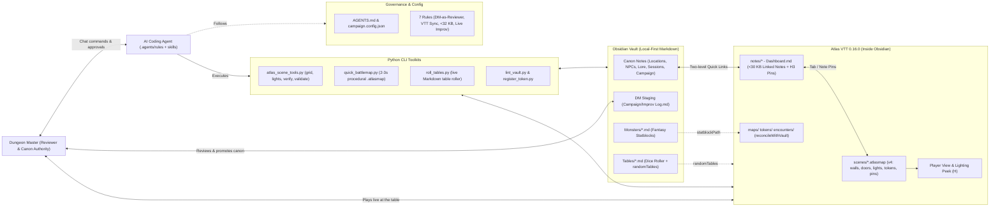

# Demiurge Core


**Demiurge Core** is an open-source, local-first **agentic Dungeon Master framework** for running D&D 5e campaigns with **[Obsidian](https://obsidian.md/)** and **[Atlas VTT 0.16.0](https://github.com/atlas-vtt/atlas-vtt)**.

It pairs strict narrative governance (**DM-as-Reviewer** — the AI never invents canon behind your back) with 9 modular agent skills, a clean two-level Obsidian vault architecture, and working Python CLI toolkits for **instant procedural battlemaps**, **Atlas VTT scene validation**, **token registration**, and **live rollable Markdown tables**.

---

## Key Features

- **DM-as-Reviewer Governance (`AGENTS.md` + 7 Rules):** Clear boundaries separating technical automation (XP budgets, YAML, `.atlasmap` assembly, validation) from narrative canon (NPCs, lore, temples, handouts, secrets).
- **Zero-Overlap Skill Architecture (9 Modular Skills):** Distinct scopes for session prep, live improvisation, instant tactical battlemaps, canonical dungeon building, encounter balancing, statblocks, token art registration, post-session recaps, and living-world faction clocks.
- **Two-Level Vault Model (`< 32 KB` Atlas Safe):** Separates rich Lore/Location notes from ultra-lean Atlas VTT Linked Note Dashboards (`< 30 KB`, respecting Atlas VTT's hard 32 KB ceiling) with 1:1 `### H3` Note Pin anchors and **pre-calculated party passive checks** (`⚡ Automatic Passive` vs. `🎲 Active Roll`).
- **4 Working Python CLI Toolkits:**
  1. `atlas_scene_tools.py` — Grid alignment previews, glow/torch light-source detection, scene visual verification renders, and strict `.atlasmap` + Dashboard validation.
  2. `quick_battlemap.py` — Generates complete **Atlas VTT 0.16.0 (`schema v4`)** battlemaps in 2–3 seconds (5 procedural presets: `whiteboard`, `alley`, `road`, `hills`, `interior`) with walls, openable doors, secret doors, dynamic lighting (`day` / `dusk` / `night`), snapped tokens, Note Pins, and a linked DM Dashboard. Supports both `feet` and `meters`.
  3. `roll_tables.py` — Dynamically indexes and rolls any Markdown table (`| dN | ... |`) in `<Vault>/Tables/`, compatible with Obsidian Dice Roller and Atlas VTT `randomTables`.
  4. `scripts/lint_vault.py` & `register_token.py` — Validates YAML frontmatter, broken `[[wikilinks]]`, and Atlas VTT's 32 KB file limit, plus crops/registers `400×400` WebP tokens for Atlas `0.16.0`.
- **Ready-to-Open `template-vault/`:** 100% fictional, spoiler-free, copyright-safe starter vault complete with a DM Screen, empty World State & Improv Staging Log, multi-compatible demo random table, fictional example party (`Mira`, `Kael`, `Bram`), and a pre-validated Atlas VTT demo scene (`Demo - Oakhaven Alley`).

---

## Architecture: Agent ↔ Obsidian ↔ Atlas VTT `0.16.0`



---

## Required & Recommended Obsidian Plugins

Install these community plugins inside your Obsidian vault (`Settings → Community plugins`):

| Plugin | ID | Required? | Role in Framework |
| :--- | :--- | :---: | :--- |
| **[Atlas VTT](https://github.com/atlas-vtt/atlas-vtt)** (`0.16.0+`) | `atlas-vtt` | **Required** | Local-first VTT: `.atlasmap` v4 scenes, dynamic lighting, walls/doors, tokens, Note Pins, Quests, Encounters, Player View |
| **[Fantasy Statblocks](https://github.com/Obsidian-TTRPG-Community/fantasy-statblocks)** | `obsidian-5e-statblocks` | **Required** | Renders ```` ```statblock ```` YAML blocks and feeds initiative/HP/tooltips into Atlas VTT |
| **[Dice Roller](https://github.com/Obsidian-TTRPG-Community/dice-roller)** | `obsidian-dice-roller` | **Required** | Inline dice rolls (`dice: 1d6`) and clickable Markdown random tables (`^block-id`) |
| **[Iconize](https://github.com/FlorianWoelki/obsidian-iconize)** | `obsidian-icon-folder` | Recommended | Displays folder and note emojis from YAML `icon:` fields |
| **[Extended Graph](https://github.com/ElsaTam/obsidian-extended-graph)** | `extended-graph` | Optional | Enhanced graph visualization across wikilinks and frontmatter relationships |

---

## 5-Minute Quick Start

### 1. Clone & Install Python Dependencies
Requires **Python 3.10+**.

```bash
git clone https://github.com/tognonm/demiurge-core.git
cd demiurge-core
python -m pip install -r requirements.txt
```

### 2. Test the Demo Vault & Toolkits Immediately
All scripts default to `template-vault/` via `campaign.config.json`:

```bash
# 1. Lint the starter vault (YAML frontmatter, wikilinks, Atlas 32 KB limit)
python scripts/lint_vault.py --strict-links

# 2. List rollable Markdown tables & presets
python .agents/skills/live-improv/scripts/roll_tables.py --list

# 3. Simulate an instant procedural battlemap without writing files
python .agents/skills/quick-battlemap/scripts/quick_battlemap.py --preset alley --lighting night --enemies "Road Raider:2,Skeleton Sentry:1" --dry-run

# 4. Validate the included Atlas VTT 0.16.0 demo scene
python .agents/skills/dungeons-and-maps/scripts/atlas_scene_tools.py validate "template-vault/atlas-vtt/collections/Campaign/scenes/Demo - Oakhaven Alley.atlasmap" --dashboard "template-vault/atlas-vtt/collections/Campaign/notes/Demo - Oakhaven Alley.md"
```

### 3. Open in Obsidian
1. Open Obsidian → **Open folder as vault** → select `template-vault/` (or copy `template-vault/` to `Vault/` for your real campaign).
2. Enable **Atlas VTT**, **Fantasy Statblocks**, and **Dice Roller**.
3. Open `DM Screen.md` and launch the Atlas VTT scene **`Demo - Oakhaven Alley`**:
   - Press **`Tab`** to toggle the Linked DM Dashboard.
   - Hold **`H`** (*Lighting Peek*) to preview Dynamic Lighting through the party's eyes.
   - Click either warehouse door on the map to open it live.

### 4. Customize for Your Own Campaign
1. Copy `template-vault/` to `Vault/` (optional) and edit **`campaign.config.json`**:
   - Set `campaign_name`, `vault_dir`, `atlas_collection`, `atlas_campaign_id`, grid units (`feet` / `5` or `meters` / `1.5`), and your real **`party`** (names, HP, token paths, passive Perception/Investigation/Insight, and torchbearer).
2. Update the `{{CAMPAIGN_NAME}}` placeholders and party passive reference in **`AGENTS.md`**.
3. Open the repository root in your AI coding agent (Antigravity, Cursor, Claude Code, Codex, or any agent reading `AGENTS.md` and `.agents/`).

---

## Example Chat Commands (With Your AI Agent)

| Tabletop Moment | Example Prompt in Chat | Skill Activated |
| :--- | :--- | :--- |
| **Session prep** | *"Prep Session 4: the party investigates the missing merchant wagon in Oakhaven."* | `session-prep` (reads `World State.md`, proposes modular nodes & asks for DM sign-off) |
| **Canonical dungeon** | *"Here is a battlemap PNG for the Old Tower Crypt. Check the grid alignment and propose room labels A–E."* | `dungeons-and-maps` + `atlas_scene_tools.py` |
| **Sudden ambush live** | *"Instant alley battlemap at night with 2 Road Raiders and 1 Skeleton Sentry."* | `quick-battlemap` + `quick_battlemap.py` (2–3s) |
| **Live improvisation** | *"Give me a quick NPC and a street complication right now."* | `live-improv` + `roll_tables.py` (6–8 line table-ready reply + staging prompt) |
| **Custom monster / token** | *"Create a CR 1/2 skeleton guard statblock and register its token art for Atlas."* | `statblock-5e` + `atlas-token-art` + `register_token.py` |
| **Encounter balance** | *"Balance a Moderate encounter for three Level 3 PCs and roll appropriate loot."* | `encounters-and-loot` |
| **Post-session wrap-up** | *"Here are my rough notes from tonight's session. Write the recap, advance faction clocks, and triage the Improv Log."* | `session-recap` + `living-world` + `lint_vault.py` |

---

## Repository Structure

```text
.
├── AGENTS.md                        # Core governance & vault conventions template
├── campaign.config.json             # Central config (vault, Atlas collection, units, party, passives, presets)
├── docs/                            # Project hero banner (16:9) & GitHub social preview (1280x640)
├── requirements.txt                 # Python dependencies (Pillow, numpy, PyYAML)
├── scripts/
│   └── lint_vault.py                # YAML, wikilink & Atlas 32 KB limit checker
├── .agents/
│   ├── rules/                       # 7 modular governance rules
│   │   ├── dm-reviewer-narrative-authority.md
│   │   ├── session-lifecycle.md
│   │   ├── vtt-sync-boundaries.md
│   │   ├── scene-and-dashboard-standards.md
│   │   ├── live-improv-and-boundaries.md
│   │   ├── obsidian-plugins.md
│   │   └── art-style.md
│   └── skills/                      # 9 specialized DM skills + Python toolkits
│       ├── dungeons-and-maps/       # + scripts/atlas_scene_tools.py + resources/dashboard_template.md
│       ├── quick-battlemap/         # + scripts/quick_battlemap.py (5 procedural presets)
│       ├── live-improv/             # + scripts/roll_tables.py (dynamic Markdown roll engine)
│       ├── atlas-token-art/         # + scripts/register_token.py + resources/prompt_template.md
│       ├── session-prep/
│       ├── session-recap/
│       ├── living-world/
│       ├── encounters-and-loot/
│       └── statblock-5e/            # + resources/statblock_template.md
└── template-vault/                  # 100% fictional, ready-to-open demo Obsidian + Atlas VTT vault
    ├── DM Screen.md
    ├── Campaign/                    # World State, Improv Log, Story Arcs, Players, Quests, Factions
    ├── Locations/                   # Two-level demo location (Oakhaven Village)
    ├── Monsters/                    # Minimal SRD-compatible demo statblocks
    ├── Sessions/                    # Empty Campaign Log template
    ├── Tables/                      # Dice Roller + Atlas randomTables + roll_tables.py demo table
    └── atlas-vtt/                   # Pre-validated Atlas VTT 0.16.0 demo scene, tokens & dashboard
```

---

## Copyright & Privacy Safeguards

- This repository contains **zero copyrighted rulebook text** and **zero real campaign spoilers**.
- `.gitignore` explicitly excludes `Sources/`, `Manuals/`, `Reference/`, and `Archive/` so private PDFs or personal rulebooks kept locally are never committed.
- Minimal monster examples in `template-vault/Monsters/` follow standard D&D 5e open mechanics compatible with the **SRD 5.1 (CC-BY-4.0)** format.

---

## Credits & Acknowledgments

- **[Obsidian](https://obsidian.md/)** — Local-first Markdown knowledge base powering the entire DM vault.
- **[Atlas VTT](https://github.com/atlas-vtt/atlas-vtt)** ([atlas-vtt.dev](https://atlas-vtt.dev/)) — Open-source local-first Virtual Tabletop inside Obsidian that makes `.atlasmap` v4 scenes, dynamic lighting, linked dashboards, and Player View possible.
- **[Obsidian TTRPG Community](https://github.com/Obsidian-TTRPG-Community)** — Maintainers of **[Fantasy Statblocks](https://github.com/Obsidian-TTRPG-Community/fantasy-statblocks)** and **[Dice Roller](https://github.com/Obsidian-TTRPG-Community/dice-roller)**.
- **[Iconize](https://github.com/FlorianWoelki/obsidian-iconize)** & **[Extended Graph](https://github.com/ElsaTam/obsidian-extended-graph)** — Community Obsidian plugins for visual navigation and graph workflows.
- **Systems Reference Document 5.1 (SRD 5.1)** by Wizards of the Coast LLC, licensed under [CC-BY-4.0](https://creativecommons.org/licenses/by/4.0/).

---

## License

This project is released under the [MIT License](LICENSE).
