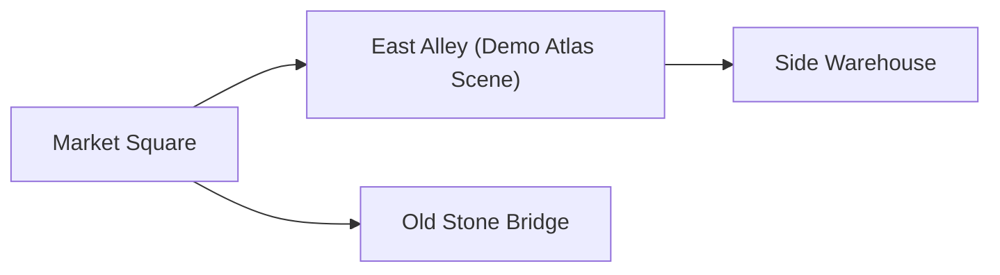

# 🏘️ Oakhaven Village *(Demo Location — Two-Level Model)*

> [!TIP] **Atlas VTT Quick Link**
> 🗺️ **Atlas Scene:** `Demo - Oakhaven Alley` | 🛡️ **DM Dashboard:** [[Demo - Oakhaven Alley]]

## 5-Second Sensory Read-Aloud
- **Sight:** Timber-framed cottages with dark slate roofs crowd around a cobbled crossroads lit by swinging brass oil lanterns.
- **Sound:** The distant ring of a smith's hammer mingles with rushing creek water beneath the stone bridge and creaking wagon axles.
- **Smell / Atmosphere:** Crisp pine resin, fresh hearth bread, and damp cobblestones after a passing drizzle.

---

## Overview
A 100% fictional crossroads village demonstrating the **two-level vault model** (`scene-and-dashboard-standards.md`): this compendium note holds lore, contacts, and flavor, while the tactical combat card (`< 30 KB`) lives inside the Atlas VTT collection at [[Demo - Oakhaven Alley]].

---

## 3 Improvised Quick Contacts *(Fictional Examples)*
1. **Orin the Carpenter:** Stocky craftsman in a sawdust-dusted leather apron; needs strong hands to haul a broken wagon axle. *"Good oak never lies — unlike most brokers."*
2. **Sera the Herbalist:** Sharp-eyed elder with bundles of dried sage pinned to her shawl; looking for fresh marsh roots. *"If it smells of brimstone, it isn't one of my teas."*
3. **Nolan the Stablehand:** Quick-witted youth who recognizes every merchant cart passing through; trades gossip for a silver piece. *"I can tell whose wagon just crossed the bridge by the squeak of its wheel."*

---

## Quick Village Happenings (`d6` — Obsidian Dice Roller)

Roll live: `dice: 1d6`

| d6 | Sudden Occurrence |
| :---: | :--- |
| 1 | A merchant cart snaps a wheel, blocking entry to the east alley. |
| 2 | A town crier posts a reward for a missing supply cargo ([[Demo Quest - The Missing Wagon]]). |
| 3 | A sudden downpour clears the market square in seconds. |
| 4 | Two traders argue loudly outside the side warehouse over a broken wax seal. |
| 5 | A streetlamp flickers out right as a hooded figure slips into the shadows. |
| 6 | A stray hound trots up to the party carrying an embroidered handkerchief. |
