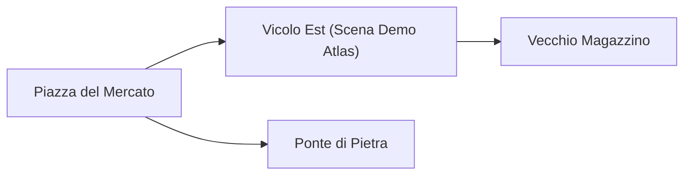

# 🏘️ Borgo di Oakhaven *(Luogo Demo — Modello a Doppio Livello)*

> [!TIP] **Atlas VTT Quick Link**
> 🗺️ **Scena Atlas:** `Demo - Vicolo di Oakhaven` | 🛡️ **Dashboard Operativa:** [[Demo - Vicolo di Oakhaven]]

## 5 Secondi di Descrizione Sensoriale (Lettura per il DM)
- **Vista:** Case a graticcio dai tetti d'ardesia scura si stringono attorno a una piazzetta lastricata, rischiarata da lanterne d'ottone appese a ganci di ferro.
- **Udito:** Il rintocco distante di un'incudine si mescola al mormorio del torrente sotto il ponte di pietra e al cigolio dei carri mercantili.
- **Olfatto / Atmosfera:** Aria fresca di resina di quercia, pane appena sfornato e pioggia leggera posata sul selciato.

---

## Panoramica
Un piccolo borgo di crocevia fittizio pensato come esempio del **modello a doppio livello** (`scene-and-dashboard-standards.md`): questa nota custodisce lore, contatti e atmosfera, mentre la scheda tattica compatta (`< 30 KB`) vive nella collezione Atlas VTT in [[Demo - Vicolo di Oakhaven]].

---

## 3 Contatti Rapidi Improvvisati *(Esempi Fittizi)*
1. **Orin il Carpentiere:** Uomo tarchiato con grembiule di cuoio e segatura tra i capelli; cerca manodopera per riparare un carro rotto. *"Il legno buono non mente mai, a differenza dei mercanti."*
2. **Sera la Speziale:** Anziana dallo sguardo vivace con sacchetti d'erbe essiccate appesi allo scialle; cerca radici di palude fresche. *"Se puzza di zolfo, non è una mia tisana."*
3. **Nolan il Ragazzo di Stalla:** Giovane sveglio che conosce tutte le targhe dei carri di passaggio; vuole una moneta d'argento in cambio di chiacchiere. *"Qui i carri li conto a orecchio prima ancora che arrivino al ponte."*

---

## Eventi Rapidi nel Borgo (`d6` — Obsidian Dice Roller)

Tira al volo: `dice: 1d6`

| d6 | Evento Imprevisto |
| :---: | :--- |
| 1 | Un carro perde una ruota bloccando il passaggio verso il vicolo est. |
| 2 | Un banditore annuncia una ricompensa per chi ritrova un carico smarrito ([[Quest Demo - Il Carro Scomparso]]). |
| 3 | Un acquazzone improvviso svuota la piazza in pochi secondi. |
| 4 | Due mercanti litigano ad alta voce davanti al magazzino per una cassa dal sigillo rotto. |
| 5 | Una lanterna si spegne proprio mentre una figura incappucciata svolta nell'ombra. |
| 6 | Un cane randagio segue il gruppo portando in bocca un fazzoletto ricamato. |
